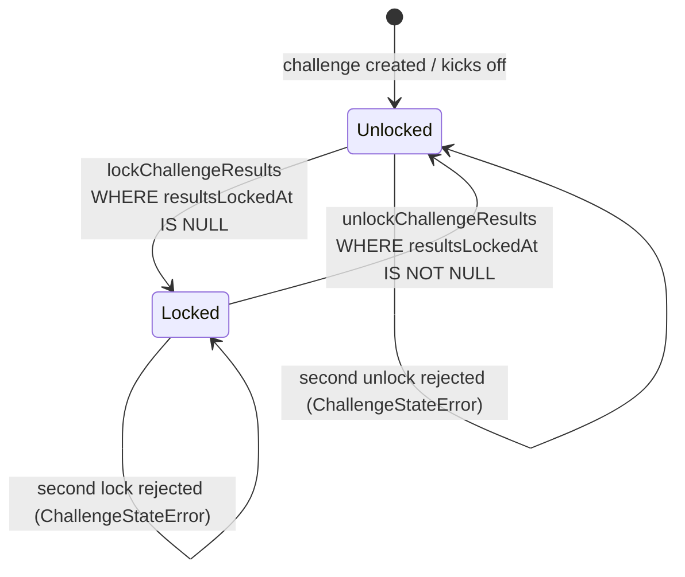
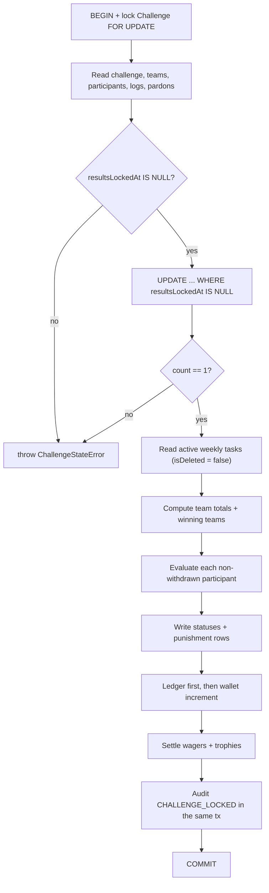

# Accountability — Results Lock & Punishment Evaluation

> **Authority:** `AGENTS.md` Law L5 (Admin Override Absolute), Law L6 (Three-Condition Accountability Invariant), Law L7 (Pure Domain Isolation)
> **Owner slice:** `features/accountability`, `features/challenges/data/{challenge-admin,participant}.repository.ts`, `features/study-logs/data/daily-study-log.repository.ts`
> **Migration:** `20261030000000_punishment_unique_per_participant`

---

## 1. Executive Summary & Scope

The results lock is the moment a challenge stops accepting new accountability inputs and fixes the outcome for every participant. It is the only operation in the product that can create a punishment, so it is deliberately the strictest transaction in the codebase.

A participant is **saved** only when all three hold at lock time:

1. every challenge-linked weekly task is completed,
2. the declared target hours are met,
3. the participant's team is a winning team (every team at the maximum combined hours; ties never punish).

If any condition fails, the participant is `PUNISHED`, regardless of team.

### In scope

- `lockChallengeResults` / `unlockChallengeResults` (`challenge-admin.repository.ts`).
- Participant withdrawal (`participant.repository.ts#applyParticipantWithdrawal`).
- Daily study logging (`daily-study-log.repository.ts#upsertDailyStudyLog`).
- Task goal linkage (`challengeId` on weekly tasks).
- The `PunishmentRecord` unique invariant.
- Reward wallet credit, audit atomicity, wager/trophy settlement inside the lock.

### Non-goals

- The offline task revision protocol, queue ownership, cross-tab locking.
- Roster moves that change `teamId` (tracked in §6 as guard-adoption work).
- Product policy for logs dated after `endAt`; the lock reads a consistent set, it does not redefine the cut-off.

---

## 2. Domain State Machine & Decisions



### The serialisation point

The challenge row is the single lock:

| Operation                    | Row lock                | Transition predicate                    |
| :--------------------------- | :---------------------- | :-------------------------------------- |
| `lockChallengeResults`       | `SELECT ... FOR UPDATE` | `resultsLockedAt IS NULL`               |
| `unlockChallengeResults`     | `SELECT ... FOR UPDATE` | `resultsLockedAt IS NOT NULL`           |
| `applyParticipantWithdrawal` | `SELECT ... FOR UPDATE` | `challenge.resultsLockedAt IS NULL`     |
| `upsertDailyStudyLog`        | `SELECT ... FOR SHARE`  | reject if `resultsLockedAt IS NOT NULL` |
| task `challengeId` write     | `SELECT ... FOR SHARE`  | reject if `resultsLockedAt IS NOT NULL` |

`FOR UPDATE` conflicts with `FOR SHARE`, so an input writer either commits before the lock reads it or waits and is then rejected. There is no window in which an input is written after the decision and counted.

### Lock order

Every transaction that touches a challenge takes locks in this order:

`Challenge` → `ChallengeParticipant` → `Task` / `Team` → `Wallet` → `LedgerTransaction` / `TrophyTransaction`.

Do not introduce a flow that takes `Wallet` before `Challenge`.

### Decision flow



---

## 3. Database Persistence Models

### `Challenge`

`resultsLockedAt DateTime?` is the lock flag. `isDeleted` is checked before locking; a soft-deleted challenge cannot be locked.

### `ChallengeParticipant`

`isWithdrawn` is read inside the lock transaction. Withdrawn participants are excluded from both evaluation and team totals, and their rows are not written by the lock.

### `PunishmentRecord`

```prisma
model PunishmentRecord {
  id            String  @id @default(cuid())
  challengeId   String
  participantId String
  isPardoned    Boolean @default(false)
  // ...
  @@unique([challengeId, participantId])
}
```

Row presence means punished. Pardoned rows are kept across re-locks; non-pardoned rows are deleted and recreated. The unique constraint makes double settlement fail loudly instead of duplicating.

**Operator pre-check before applying the migration:**

```sql
SELECT "challengeId", "participantId", COUNT(*) AS duplicates
FROM "PunishmentRecord"
GROUP BY 1, 2
HAVING COUNT(*) > 1;
```

If it returns rows, run `apps/web/scripts/dedupe-punishment-records.ts` (dry-run by default) against a local copy first.

### `DailyStudyLog`

The lock reads `dailyStudyLogs` through the participant include. The write path (`upsertDailyStudyLog`) takes `FOR SHARE` on the challenge and rejects after lock.

### `Task`

Only weekly tasks with `challengeId = <challenge>` and `isDeleted = false` are requirements. Soft-deleted goals are not requirements and cannot be toggled (the sync path filters `isDeleted: false`).

`resolveTaskChallengeId` / `validateTaskChallengeId` exclude soft-deleted challenges.

---

## 4. Developer & Operator Usage Guide

### Lock / unlock (server only)

```ts
import {
   lockChallengeResults,
   unlockChallengeResults,
} from "@/features/challenges/data/challenge-admin.repository";

await lockChallengeResults(challengeId, {
   id: admin.id,
   username: admin.username,
});
await unlockChallengeResults(challengeId, {
   id: admin.id,
   username: admin.username,
});
```

Both throw `ChallengeStateError` when the transition predicate does not hold. Server actions map that to `ALREADY_LOCKED` / `NOT_LOCKED`.

### Guard a new accountability input

If you add a write that changes hours, goals, withdrawal, team membership, or target seconds, take the shared lock in the same transaction:

```ts
await tx.$queryRaw`SELECT "id" FROM "Challenge" WHERE "id" = ${challengeId} FOR SHARE`;
const [row] = await tx.$queryRaw<{ resultsLockedAt: Date | null }[]>`
  SELECT "resultsLockedAt" FROM "Challenge" WHERE "id" = ${challengeId}
`;
if (!row || row.resultsLockedAt != null) {
   throw new ChallengeStateError("Challenge results are locked.");
}
```

Then perform the write with the same `tx`.

### Task goal linkage

```ts
await assertChallengeWritable(tx, challengeId); // features/tasks/data/task.repository.ts
```

`createTask` and `updateTask` are transactional and guard both linking and unlinking. In the
sync path, a mutation that would change an existing weekly goal while results are locked
returns `conflict` / `challenge_locked` with the current row, so the client reverts to the
server state; a new task with a locked `challengeId` is created unlinked.

### Operator runbook

```bash
# 1. pre-check duplicates (read-only)
psql "$DATABASE_URL" -c 'SELECT "challengeId","participantId",COUNT(*) FROM "PunishmentRecord" GROUP BY 1,2 HAVING COUNT(*) > 1;'

# 2. dedupe on a local copy (dry run first)
npx tsx --env-file=.env apps/web/scripts/dedupe-punishment-records.ts
npx tsx --env-file=.env apps/web/scripts/dedupe-punishment-records.ts --apply

# 3. apply the migration
npm run db:migrate:deploy   # or your normal migration command

# 4. prove the invariants on local/staging
npx tsx --env-file=.env apps/web/scripts/verify-lock-concurrency.ts --challenge=<id> --dry-run
npx tsx --env-file=.env apps/web/scripts/verify-lock-concurrency.ts --challenge=<id> --apply
```

The verifier locks a real challenge. Use a disposable local/staging challenge; it refuses a non-local `DATABASE_URL` unless `--force-host` is passed.

---

## 5. Security & Authorization Rules

- `lockChallengeResultsAction` / `unlockChallengeResultsAction` call `requireAdminUser()` before touching the repository. `participant-stats` and scoreboard views remain public/spectator.
- Participants can withdraw only their own enrollment; `withdrawParticipant` resolves the participant from the session user. Admins use `removeChallengeParticipant`, which funnels through the same `applyParticipantWithdrawal` guard.
- The lock audit (`CHALLENGE_LOCKED`) records the actor, prior `endAt`, winning teams, and the saved/punished counts. It is written with `{ transactionClient: tx }`, so a rolled-back lock leaves no audit row.
- Unlock refunds wagers and reverses trophies in the same transaction. Pardoned records are deleted by unlock as documented in the feature behavior.
- Study-log writes are authorized by `requireOwnedParticipant`; the guard is an additional invariant, not a replacement for session checks.

---

## 6. Feature Lifecycle & Decommissioning

**Lifecycle:** no feature flag. This is a correctness fix on an existing path, so it ships with the code.

**Guard-adoption follow-ups.** These writers change a lock input and must take `FOR SHARE` on the challenge before writing; they are not part of the first slice:

| Writer                   | Input           | Location                                                     |
| :----------------------- | :-------------- | :----------------------------------------------------------- |
| Admin team move          | `teamId`        | `challenge-admin.repository.ts#reassignParticipantTeam`      |
| Admin target edit        | `targetSeconds` | `challenge-admin.repository.ts#adminUpdateParticipantTarget` |
| Admin status edit        | `status`        | `challenge-admin.repository.ts` participant status mutation  |
| Roster rebalance         | `teamId`        | team assignment sections                                     |
| Kickoff declaration lock | `targetSeconds` | `kickoffChallenge`                                           |

Add a regression test for each new writer that asserts `FOR SHARE` is taken.

**Decommissioning:** if the lock model is replaced (for example by an append-only outcome ledger), remove the guards together with the state machine in this document. Do not remove the `PunishmentRecord` unique constraint while punishment row presence is still the source of truth.
