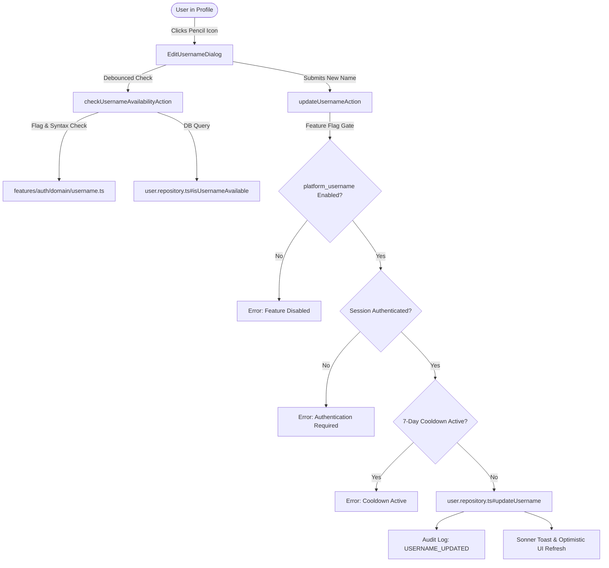

# Identity — Platform Usernames & Identity Unification

> **Authority:** `AGENTS.md` Law L1 (Single Entity & Mathematical Unity), Law L4 (Discord Identity Primacy), Law L7 (Pure Domain Isolation), Law L9 (Zero-State & Error Resilience)  
> **Feature Specifications:** `FEATURES.md` (Scholar Profiles, Scoreboards)  
> **Feature Flag:** `platform_username` (`FEATURE_FLAG_KEYS.platformUsername`)  
> **Database Migration:** `20261105000000_user_username_ci_unique`  
> **Primary Layers:** `packages/database/`, `apps/web/features/auth/`, `apps/web/features/participant-stats/`, `apps/web/features/leaderboard/`, `apps/web/features/trophies/`, `apps/web/features/study-logs/`, `apps/web/components/ui/`

---

## 1. Executive Summary & Scope

Historically, scholars on HoldMeToIt were identified primarily by their Discord display name, with their Discord handle displayed on a secondary sub-line as `@username`. This caused visual redundancy across profile cards, scoreboards, and header capsules.

The **Platform Username** feature introduces unified, editable platform usernames with:
1. **Case-Preserving Storage with Case-Insensitive Uniqueness:** Stored exactly as typed by the scholar, but enforced globally unique via a PostgreSQL expression index `LOWER(username)`.
2. **7-Day Cooldown Protection:** Scholars can edit their platform username once every 7 days (`usernameChangedAt DateTime?`), preventing impersonation churn.
3. **Safe Rollout behind Feature Flag:** All username editing and availability checking is guarded behind the `platform_username` feature flag.
4. **Complete UI Identity Unification:** Eliminates duplicate display names and separate `@username` sub-lines across User Profiles, Challenge Leaderboards, Trophy Leaderboards, Home Cockpit Welcome banners, and Global Header Capsules.
5. **Trophy Badge Gating:** Gated the profile `Recruit (0 trophies)` badge behind the `global_leaderboard` feature flag.

---

## 2. Architecture & Domain Invariants



### 2.1 Pure Domain Rules (`features/auth/domain/username.ts`)

- **Syntax & Constraints:**
  - Length: 3 to 30 characters.
  - Allowed characters: Letters, numbers, and underscores (`/^[a-zA-Z0-9_]{3,30}$/`).
  - Leading/trailing underscores and consecutive underscores are prevented or cleaned via `sanitizeUsernameCandidate`.
- **Reserved Keywords Blacklist:**
  - System and routing collisions are prohibited case-insensitively: `admin`, `administrator`, `moderator`, `mod`, `api`, `auth`, `login`, `logout`, `profile`, `challenge`, `challenges`, `dashboard`, `leaderboard`, `settings`, `system`, `root`, `support`, `bot`, `holdmetoit`, `guest`, `null`, `undefined`.
- **7-Day Cooldown Engine:**
  - `USERNAME_COOLDOWN_DAYS = 7`.
  - `isUsernameChangeAllowed(usernameChangedAt, now)`: Returns `true` if `usernameChangedAt` is `null` or $\ge 7\text{ days}$ have elapsed since the last change.
  - `getUsernameCooldownDaysRemaining(usernameChangedAt, now)`: Returns integer days remaining (ceiling) or `0` if eligible.

---

## 3. Database & Data Integrity

### 3.1 Migration `20261105000000_user_username_ci_unique`

PostgreSQL enforces uniqueness case-insensitively using a partial expression index:

```sql
CREATE UNIQUE INDEX IF NOT EXISTS "User_lower_username_key"
ON "User" (LOWER("username"))
WHERE "username" IS NOT NULL;
```

This guarantees:
- `Alice` and `alice` cannot coexist (no spoofing or handle hijacking).
- `User.username` stores the exact casing desired by the scholar (`Afnan_Prime`).
- `User.usernameChangedAt` tracks timestamp of last change to enforce the 7-day cooldown.

### 3.2 Pre-Migration Deduplication Script (`apps/web/scripts/dedupe-usernames.ts`)

For existing databases with legacy conflicting Discord handles, a dry-run/apply CLI script identifies duplicates on `LOWER(username)` and safely appends `_1`, `_2` deterministically.

---

## 4. API & Server Actions

### 4.1 `checkUsernameAvailabilityAction(candidate: string)`
- Returns `{ isAvailable: boolean, reason?: string }`.
- Gated behind `FEATURE_FLAG_KEYS.platformUsername`.
- Returns `isAvailable: true` if the candidate matches the caller's own current username.

### 4.2 `updateUsernameAction(newUsername: string)`
- Enforces authentication (`requireSessionUser()`).
- Evaluates `platform_username` feature flag.
- Validates syntax and reserved word blacklist via Zod schema (`usernameSchema`).
- Asserts 7-day cooldown via `isUsernameChangeAllowed`.
- Atomically updates `username` and sets `usernameChangedAt = new Date()`.
- Emits audit log event `AuditLogType.USERNAME_UPDATED` with previous and new username.
- Revalidates `/profile`, `/profile/[userId]`, and `/`.

---

## 5. Presentation Layer & UI Unification

### 5.1 Profile Header (`features/participant-stats/presentation/global-profile-view.tsx`)
- **Single Unified Scholar Name:** Line 1 displays `currentUsername || user.displayName`.
- **Pencil Edit Trigger:** `<EditUsernameDialog currentUsername={...} usernameChangedAt={...} />` renders adjacent to the username only when `isOwnProfile && isPlatformUsernameEnabled`.
- **Trophy Rank Gating:** The `Recruit (0 trophies)` badge (`TrophyRoleBadge`) is wrapped in `{isGlobalLeaderboardEnabled && (...) }`, preventing clutter until competitive trophies rollout.
- **Removed Duplicate Handle:** Obsolete separate `<p className="...">@{user.username}</p>` sub-line removed.

### 5.2 Edit Username Modal (`features/auth/presentation/edit-username-dialog.tsx`)
- Radix Dialog triggered by an Obsidian pencil button.
- Real-time debounced availability check showing green checkmark or red conflict error.
- Displays 7-day cooldown rules and remaining days if on cooldown.
- Pending spinner and transition feedback; automatically updates UI and closes dialog on success.

### 5.3 Challenge Leaderboard (`features/leaderboard/presentation/challenge-leaderboard-tab.tsx`)
- **Podiums (Rank 1, 2, 3):** Renders `{top.username || top.displayName}`.
- **Main Standings Table (Desktop & Mobile):**
  - Line 1: Primary link renders `{entry.username || entry.displayName}`.
  - Line 2: Removed redundant `@username` text; cleanly hosts `SickStatusBadge` and `PaceBadge`.
- **Unassigned Scholars Table:** Renders `{entry.username || entry.displayName}` and removes duplicate handle line.
- **Flat List & Team Roster Cards:** Renders `{entry.username || entry.displayName}` with no duplicate `@username` line.

### 5.4 Global Trophy Leaderboard (`features/trophies/presentation/trophy-leaderboard-view.tsx`)
- Row header displays `{entry.username || entry.displayName}`.
- Meta subline removes redundant `@{entry.username}` and cleanly displays career record: `{wins}W / {losses}L ({winRate}%)`.

### 5.5 Home Cockpit & Global Navigation
- **Home Cockpit (`home-cockpit-view.tsx`):**
  - `effectiveDisplayName` prioritizes `user?.username || cockpit?.participant.username`.
  - Renders "Welcome `{username}`" with link to scholar profile.
- **Global Header Capsule (`components/ui/header.tsx`):**
  - Prioritizes `user.username || user.displayName || user.name || "Companion"`.

---

## 6. Verification & Quality Gates

| Test Suite                                              | Scope                                           | Status |
| :------------------------------------------------------ | :---------------------------------------------- | :----- |
| `features/auth/domain/username.test.ts`                 | Syntax, normalization, 7-day cooldown, Zod      | Pass   |
| `features/auth/data/user.repository.test.ts`            | DB queries, CI unique lookups, updates          | Pass   |
| `features/auth/api/username.actions.test.ts`            | Flag gating, cooldown rejection, audit logs     | Pass   |
| `features/auth/presentation/edit-username-dialog.test.` | Modal rendering, availability check, save flows | Pass   |
| `features/participant-stats/.../global-profile-view.`   | Header name, pencil toggle, trophy flag gating  | Pass   |
| `features/leaderboard/.../challenge-leaderboard-tab.`   | Podiums, table rows, mobile cards, team view    | Pass   |
| `features/trophies/.../trophy-leaderboard-view.`        | Row title, record line, pagination              | Pass   |
| `features/study-logs/.../home-cockpit-view.`            | Welcome header link username prioritization     | Pass   |
| `components/ui/header.test.tsx`                         | User capsule username prioritization            | Pass   |
