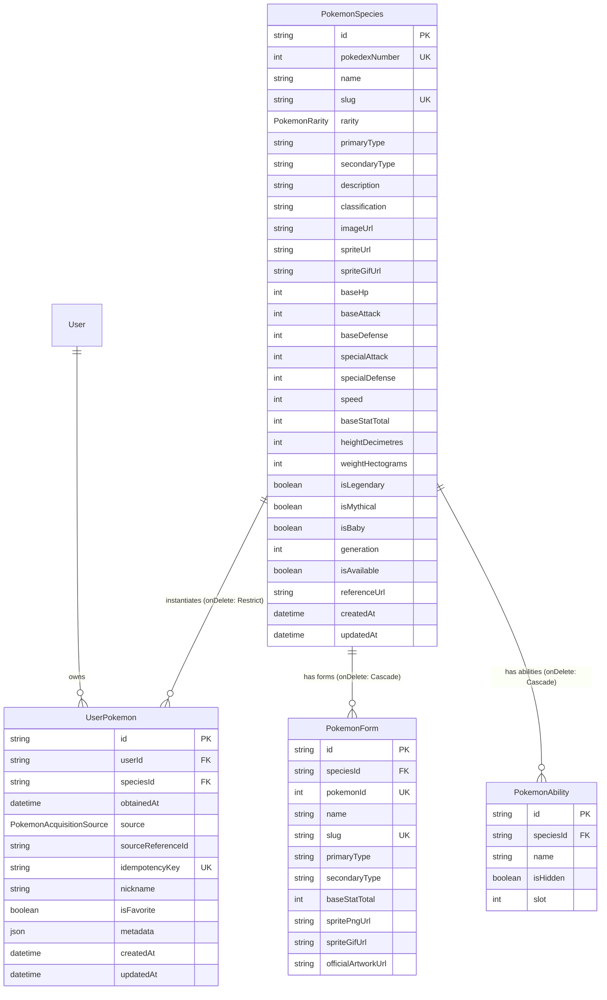

# Pokémon Catalogue, Collection & Progression Foundation (Phase 3)

> **Project:** HoldMeToIt  
> **Status:** Ratified Implementation Architecture (Phase 3 Foundation)  
> **Storage:** PostgreSQL (via Prisma ORM 6.x)  
> **Runtime:** Next.js 14+ App Router (Server-Authoritative Evaluation)  
> **Reference:** [Official Pokémon Pokédex](https://www.pokemon.com/us/pokedex)  
> **Last Updated:** 2026-10-15

---

## 1. Executive Summary & Product Role

HoldMeToIt is primarily a gamified study and accountability platform. Phase 3 introduces the **Pokémon Catalogue, Collection & Progression Foundation**, providing participants with a meaningful, study-backed long-term collection goal connected to their sustained study habits and earned virtual coins.

### Core Non-Negotiables & Rules

1. **Study Accountability First:** Pokémon companions complement study effort; they never replace the core mission of curing burnout and sustaining focus.
2. **Strict Economy Invariance:**
   - Earning rate remains strictly locked at **100 coins per 3,600 eligible study seconds**.
   - Pokémon ownership does **NOT** grant combat power, betting advantages, or altered study earning rates.
   - No second currency, "candy", or Pokémon tokens. All future acquisitions integrate with the Phase 1 Wallet and Ledger.
   - Loans, overdrafts, and negative balances remain strictly prohibited.
3. **No Real-Money Purchases or Paid APIs:**
   - Zero microtransactions or pay-to-win mechanics.
   - The platform operates with zero runtime dependency on external paid or brittle scraping APIs.
4. **Data Isolation & Integrity:**
   - Species catalogue entries cannot be cascade-deleted while user instances exist (`onDelete: Restrict`).
   - Ownership is strictly server-enforced; participants cannot grant themselves Pokémon.

---

## 2. Domain Data Architecture

### 2.1 Entity Relationship Diagram



### 2.2 Rarity Hierarchy & Indicative Planning Reference

Rarity tiers are defined by the `PokemonRarity` enum with strictly increasing ranks (1 to 6) and visual star ratings:

| Rarity        | Rank | Stars | Theme Accent    | Indicative Planning Cost | Description / Examples                                               |
| :------------ | :--: | :---: | :-------------- | :----------------------: | :------------------------------------------------------------------- |
| **NORMAL**    |  1   |  1★   | Slate / Stone   |       10,000 coins       | Common companions (Caterpie, Pidgey, Rattata, Jigglypuff)            |
| **UNCOMMON**  |  2   |  2★   | Emerald Green   |       50,000 coins       | Starters & elemental basics (Bulbasaur, Charmander, Squirtle)        |
| **RARE**      |  3   |  3★   | Sky Blue        |      100,000 coins       | Notable species (Pikachu, Eevee)                                     |
| **EPIC**      |  4   |  4★   | Purple / Violet |      250,000 coins       | Formidable favorites (Gengar, Gyarados, Snorlax, Dragonite, Lucario) |
| **LEGENDARY** |  5   |  5★   | Radiant Amber   |      500,000 coins       | World shapers (Mewtwo, Lugia, Ho-Oh, Rayquaza)                       |
| **MYTHICAL**  |  6   |  6★   | Rose / Crimson  |     1,000,000 coins      | Ultimate targets (Mew, Celebi, Jirachi, Arceus)                      |

> [!NOTE]
> Indicative costs are planning reference targets for the future acquisition engine (reflecting the design goal of ~1,000 eligible study hours for Mythical tier). **No purchasing or Gacha currency deduction is implemented in Phase 3.**

---

## 3. Pokédex & Collection Progress Engine

All collection mathematics adhere strictly to **Law L7: Pure Domain Isolation** with zero ORM or framework imports.

### 3.1 Completion Percentage Formula

$$\text{Completion Percentage} = \min\left(100, \text{round}\left(\frac{\text{Unique Species Owned}}{\text{Total Available Catalogue Species}} \times 100, 1\right)\right)$$

### 3.2 Denominator Invariance & Division-by-Zero Safety

- Only species with `isAvailable: true` count toward the denominator. Retired, unreleased, or disabled species are excluded.
- If total available species is 0 (e.g. unseeded database), progress evaluates safely to `0%` without throwing runtime errors.
- Duplicate copies of a species increment `totalInstancesCount` and the species badge (`xN Owned`), but do not artificially inflate the unique progress percentage.

### 3.3 Mastery Tiers

- **Apprentice Trainer:** 0% – 34.9%
- **Avid Collector:** 35.0% – 74.9%
- **Master Collector:** 75.0% – 99.9%
- **Pokédex Champion:** 100.0%

---

## 4. Security & Access Control

1. **Server-Side Authorization (No Client Grants):**
   - The repository method `grantUserPokemon` is internal to the domain and **not** exposed as a Next.js Server Action or REST endpoint.
   - Future acquisition (Gacha, study milestones) will call this internally with an `idempotencyKey` to guarantee exactly-once delivery.
2. **Spectator Mode (Law L4):**
   - Guests can freely browse the Pokédex catalogue at `/pokemon` and view species stats, types, and descriptions.
   - Collection stats and ownership markers are conditionally rendered for authenticated sessions.
3. **Cross-Participant Isolation:**
   - All collection queries enforce `where: { userId }` extracted directly from the session cookie, preventing enumeration or inspection of other participants' private collections.
4. **Admin Catalogue Controls:**
   - Species creation and availability toggles require verified `ADMIN` or `DEV` roles via `requireAdminUser()`.

---

## 5. Catalogue Data Lifecycle & Provenance

The Pokémon catalogue is **data-driven from the database** — `PokemonSpecies` (plus the normalized `PokemonForm` and `PokemonAbility` tables) is the single source of truth at runtime. There is no runtime file dependency: the application only ever reads the DB through `features/pokemon/data/*`.

The catalogue was populated once (1,025 canonical species + 326 alternate forms) from a curated Generations 1–9 dataset. The one-off bundle importer and its CLI have been removed; the former JSON `metadata` column was promoted into first-class columns and child tables by the `20261022000000_normalize_pokemon_catalogue` migration (see §5.1). The DB is the source of truth at runtime, and an offline seeder (`npm run db:seed:pokemon`, §5.6) can (re)populate an empty environment from a raw metadata bundle.

### 5.1 Normalized Data Model

All previously denormalized `PokemonSpecies.metadata` JSON has been promoted to typed columns and child tables:

- **`PokemonSpecies` scalars:** `specialAttack`, `specialDefense`, `speed`, `baseStatTotal`, `heightDecimetres`, `weightHectograms`, `baseExperience`, `color`, `captureRate`, `baseHappiness`, `hatchCounter`, `evolvesFromSpeciesId`, `evolutionChainId`, `growthRateId`.
- **`PokemonForm`** (326 rows): `pokemonId` (unique), `name`, `slug` (unique), `primaryType`, `secondaryType`, `baseStatTotal`, sprite/artwork URLs. FK `speciesId` → `PokemonSpecies` (`onDelete: Cascade`).
- **`PokemonAbility`**: `name`, `isHidden`, `slot`; `@@unique([speciesId, name])`, FK `speciesId` → `PokemonSpecies` (`onDelete: Cascade`).

The `20261022000000_normalize_pokemon_catalogue` migration performs a **one-time, non-reversible backfill**: it adds the columns/tables, transforms the existing `metadata` JSON already in the DB into the new shape, then drops the `metadata` column. Take a DB snapshot before deploying.

To rebuild the catalogue from scratch (e.g. after a DB reset), run the offline seeder against a raw PokéAPI/Veekun dump: `npm run db:seed:pokemon -- --file=<bundle.json>` (see §5.6).

### 5.3 Provenance & Legal Licensing Constraints

- **Dataset Origin:** Curated from the open-source PokéAPI / Veekun relational database project and Pokémon Showdown battle sprite archives.
- **Intellectual Property:** Pokémon characters, names, sprites, and artwork are trademarks and copyrights of **Nintendo**, **Creatures Inc.**, and **GAME FREAK Inc.**
- **Fair-Use Scope:** HoldMeToIt utilizes external asset references purely for non-commercial educational study motivation and accountability gamification.
- **Asset Fallback Resilience:** The platform does not redistribute copyrighted artwork. To eliminate host dependency failure modes, `PokemonCard` and `PokemonDetailModal` render responsive vector Pokéball silhouette fallbacks whenever external network images are blocked or unavailable.

### 5.4 Species vs. Alternate Forms Architecture

A critical architectural distinction is maintained between **Pokémon species** and **individual forms**:

- **Canonical Species (`is_default_form: true`):** Exactly 1,025 entries corresponding 1:1 with National Pokédex numbers #1 to #1025. These constitute the canonical Pokédex catalogue and collection progress denominator.
- **Form Variations (`is_default_form: false`):** 326 alternate forms (Mega Evolutions, Gigantamax, Alolan/Galarian/Hisuian/Paldean regional variants, Totem forms).
- **Consolidation Rule:** Alternate forms are grouped under their parent species in the normalized `PokemonForm` table via the `speciesId` foreign key. This strictly prevents duplicate Pokédex entries and unique constraint violations on `pokedexNumber`.

### 5.5 Separation of Official Lore from Game Economy

`is_legendary` and `is_mythical` are source classifications describing Pokémon lore, stored as distinct boolean flags (`isLegendary`, `isMythical`) in `PokemonSpecies`. They do **not** automatically dictate the game economy.

**Proposed Rarity Mapping (Product Decision Baseline):**

| Classification / Criteria     | Game Rarity   | Examples                                                                            |
| :---------------------------- | :------------ | :---------------------------------------------------------------------------------- |
| `is_mythical === true`        | **MYTHICAL**  | Mew, Celebi, Jirachi, Arceus, Pecharunt                                             |
| `is_legendary === true`       | **LEGENDARY** | Mewtwo, Lugia, Rayquaza, Dialga, Koraidon, Miraidon                                 |
| BST $\ge 540$ (Non-legendary) | **EPIC**      | Pseudo-legendaries & aces (Dragonite, Tyranitar, Metagross, Garchomp, Kingambit)    |
| $450 \le \text{BST} < 540$    | **RARE**      | Fully evolved starters & gym aces (Venusaur, Charizard, Blastoise, Gengar, Lucario) |
| $320 \le \text{BST} < 450$    | **UNCOMMON**  | Mid-stage evolutions & unevolved starters (Ivysaur, Charmeleon, Wartortle, Pikachu) |
| $\text{BST} < 320$            | **NORMAL**    | Early-route species & baby Pokémon (Caterpie, Pidgey, Rattata, Pichu)               |

> [!IMPORTANT]
> **Strict Economy Invariance:** Combat statistics (BST, Attack, Defense, HP) and rarity tiers have **zero influence** on study coin rewards, challenge deficit catch-up math, or wager betting odds.

### 5.6 Catalogue Lifecycle

- **Ingestion (one-time):** The catalogue was imported once into the DB. The former importer engine (`features/pokemon/data/pokemon-bundle-importer.ts`), its CLI (`scripts/import-pokemon-bundle.ts`), and the `db:import:pokemon` script have been removed.
- **Schema change:** `npx prisma migrate deploy` applies `20261022000000_normalize_pokemon_catalogue`, which backfills the normalized tables/columns from the existing `metadata` JSON and then drops the column.
- **Re-seed path:** `prisma/seed.ts` no longer seeds Pokémon, but the offline seeder `npm run db:seed:pokemon` (`scripts/seed-pokemon-catalogue.ts`) populates the normalized catalogue from a raw metadata bundle. Flags: `--file=<path>` (default `./pokemon_metadata.json`), `--limit=<N>`, `--dry-run`. Idempotent upserts on `slug`; each species' `forms` and `abilities` are replaced on re-run.
- **Runtime reads:** All catalogue access flows through `features/pokemon/data/pokemon-catalogue.repository.ts`; the detail queries eagerly load `forms` and `abilities`.

### 5.7 Comprehensive Data Coverage Report

```text
================================================================================
  HOLDMETOIT — POKÉMON CATALOGUE COMPOSITION
================================================================================
 Total Source Rows:       1,351
 Canonical Base Species:  1,025 (is_default_form: true, National Dex 1..1025)
 Alternate Form Variants: 326 (PokemonForm rows)
 Validated Domain Items:  1,025 (100%)
 Rejected Records:        0 (0%)

 Rarity Distribution:
 • NORMAL:      238 (23.2%)
 • UNCOMMON:    262 (25.6%)
 • RARE:        372 (36.3%)
 • EPIC:         59 (5.8%)
 • LEGENDARY:    71 (6.9%)
 • MYTHICAL:     23 (2.2%)

 Generation Coverage:
 • Gen 1:  151 species (Kanto)
 • Gen 2:  100 species (Johto)
 • Gen 3:  135 species (Hoenn)
 • Gen 4:  107 species (Sinnoh)
 • Gen 5:  156 species (Unova)
 • Gen 6:   72 species (Kalos)
 • Gen 7:   88 species (Alola)
 • Gen 8:   96 species (Galar)
 • Gen 9:  120 species (Paldea)
 Total:    1,025 distinct canonical species

 Asset URL Coverage:
 • Official Artwork: 1,025 / 1,025 (100%)
 • PNG Sprites:      1,025 / 1,025 (100%)
 • Animated GIFs:    1,025 / 1,025 (100%)
================================================================================
```

---

## 6. Catalogue Pagination, Search & Sort (Server-Side)

The Pokédex catalogue grid is fully **server-side**: each request loads one page
(`CATALOGUE_PAGE_SIZE = 24`) plus a matching `count`, instead of fetching all
~1,025 species on every visit. Pagination, search, filters and sort all resolve in
the database, so pages stay correct across the whole catalogue.

- **Constant:** `CATALOGUE_PAGE_SIZE` in `features/pokemon/domain/catalogue-query.ts`.
- **Repository (`features/pokemon/data/pokemon-catalogue.repository.ts`):** `listPokemonSpecies({ limit, offset, search, rarity, type, generation, isLegendary, isMythical, isAvailable, sortBy, ownedByUserId })` returns `{ species, totalCount }`. `ownedByUserId` scopes to species the user owns via `instances.some`.
- **Sorts:** `pokedex` (pokedexNumber asc), `name` (asc), `rarity_desc` / `rarity_asc` (DB `orderBy: { rarity }` — the `PokemonRarity` enum is declared NORMAL → MYTHICAL, matching the domain rank order, so it is correct across pages), and `recent` (collection only).
- **`recent` (collection):** Prisma can't `orderBy` a related `obtainedAt`, so it orders the user's owned set (bounded by their collection) by earliest `UserPokemon.obtainedAt` and slices — no raw SQL.
- **Action (`features/pokemon/api/pokemon.actions.ts`):** `getPokemonCatalogueAction({ scope, page, limit, search, rarity, type, generation, classification, sortBy })`. `scope: "catalogue"` is public; `scope: "collection"` derives the user id from the session server-side (never trusted from the client).
- **View (`features/pokemon/presentation/pokemon-view.tsx`):** owns filter/search/sort/page state, debounces search (~300 ms), and refetches via the server action on any change (`useTransition` + stale-response guard). Renders `DataPagination` (`itemLabel="Pokémon"`); the filter bar no longer shows a count — the pagination bar is the single source (`Showing 1–24 of 1025 Pokémon`). Any tab/search/filter/sort change resets to page 1.
- **States (Law L9):** loading skeleton, dimmed grid during a refetch, empty state, and an error state with Retry.

---

## 7. Future Expansion Roadmap

- **Phase 4 (Gacha & Pity Foundation):**
   - Connects to Phase 1 virtual currency wallet to deduct coins atomically.
   - Guarantees transactional two-phase completion (deduct coins + grant instance).
   - Pity counters and banner rotation configurations.
- **Phase 5 (Trading & Progression):**
   - Peer-to-peer duplicate trading with ledger-recorded transfer history.
   - Study-linked companion affection or level progression.
